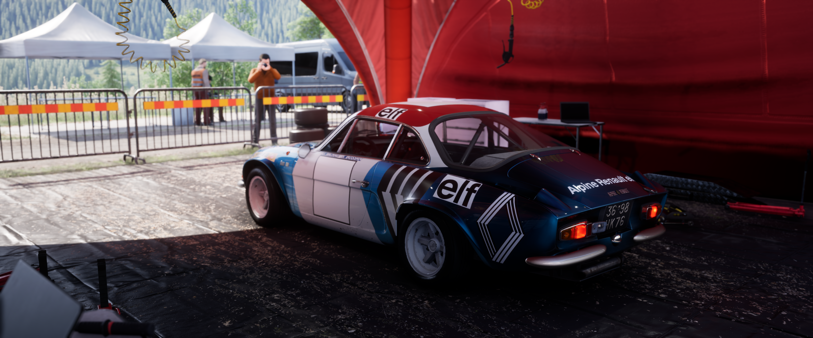
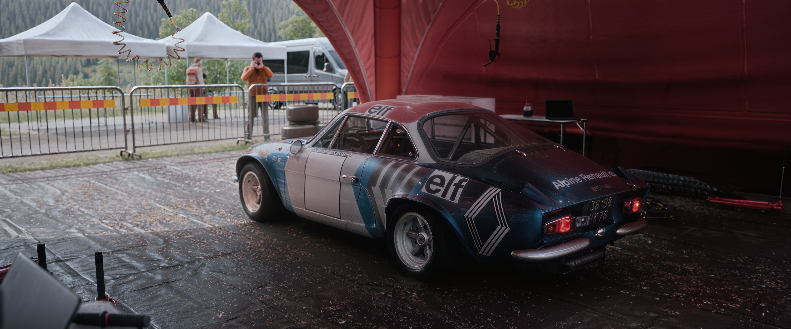
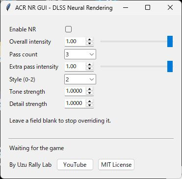

# ACR NR GUI

An unofficial tool for adjusting DLSS Neural Rendering in Assetto Corsa Rally v0.7 while the game is running. Toggle Neural Rendering and adjust the intensity, pass count, extra pass intensity, style, tone, and detail.

## Before and after

| Before | After |
| --- | --- |
|  |  |

Click either image to view it at full size.

## App screenshot

## Installation

1. Install Assetto Corsa Rally for Windows, UE4SS, and Python 3.13 with the Windows launcher and Tkinter. DLSS 5 Neural Rendering officially requires a **GeForce RTX 50 Series GPU**. Check that Neural Rendering works in the game before installing the mod. See the [NVIDIA DLSS 5 FAQ](https://www.nvidia.com/en-us/geforce/forums/geforce-graphics-cards/5/583738/dlss-5-faq/).
2. Download and extract the ZIP from [Releases](https://github.com/uzuramcrae/ACR-NR-GUI/releases/latest).
3. Close the game and copy `mod/ACRNeuralRendering` into the game's `acr/Binaries/Win64/ue4ss/Mods` folder.
4. Start the game through Steam and open `ACR-NR-GUI.cmd` from the extracted folder.

The bottom of the window shows the values read back from the game. A higher pass count increases GPU load. Leave Style, Tone strength, or Detail strength blank to stop overriding that setting.

To uninstall, close the game and remove the installed `ACRNeuralRendering` folder.

## Credits and license

If you feature this mod in a video or stream, a link to [Uzu Rally Lab](https://www.youtube.com/@Uzuramcrae) in the description is appreciated.

The code is available under the [MIT License](LICENSE).
